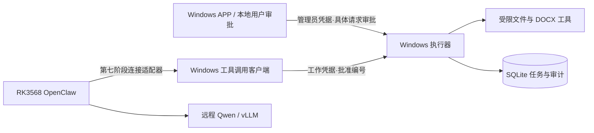

# 架构与信任边界

目前交付图中的 Windows 执行器和本地演示客户端。执行器不持有模型 API Key；模型推理保持在远程服务器。

## 模块

- Contracts：DTO、工具描述、任务状态，不依赖 Web 或 SQLite。
- Configuration：启动配置及约束，缺少密钥或文件目录时拒绝启动。
- Security：恒定时间 token 比较、角色检查、规范化 JSON 请求摘要。
- Files / Word / Tools：路径策略、原子文件发布、Open XML 与工具注册。
- Persistence：参数化 SQL、审批消费、请求去重、任务状态、审计事务。
- Tasks：单个后台工作者领取持久化任务。
- Api / Program：HTTP 接口装配、错误映射与本机监听。

所有实现留在一个宿主项目内，避免初始阶段创建不必要的分层项目。协议单独成库便于之后的桌面 APP 和连接适配器复用。

## 授权

审批端点只接受 admin token；工具客户端只持有 worker token。审批绑定请求编号、工具名称与规范化后的完整参数，五分钟过期，在入队事务中一次消费。相同请求编号与相同参数的重试返回原任务；更改参数返回冲突，不能借重试再次写文件。

审批是本地用户接口未来需要调用的基础设施；目前演示脚本是显式发起审批的开发客户端。不要把 admin token 提供给模型或盒子。

## 数据与恢复

SQLite WAL 存放审批、任务与审计。程序启动前独占数据目录的实例锁；上次残留 queued/running 任务标记 interrupted，不自动重放写入。新启动后的任务进入 queued → running → succeeded/failed。

queued 的取消阻止执行；已经开始的短文件操作可能先完成提交，完成后的取消不会回滚文件。取消接口是尽力取消，不应把返回 requested=true 理解为写入已撤销。

## 边界

拒绝 UNC、设备路径、NTFS ADS、根目录之外路径以及现存祖先中的 junction/symlink。文件操作前重新检查路径，更新既有文本需提供当前 SHA-256。该策略不隔离同一 Windows 用户控制的其他进程；不能保证对恶意本地进程的文件系统竞态防御。部署时以普通用户运行，工作目录不要同时交给不受信任程序写入。

HTTP 仅监听 IPv4 loopback，Host 限制为 localhost/127.0.0.1，拒绝携带 Origin 的浏览器请求，所有业务接口要求角色凭据。当前没有网络配对、跨设备认证或审批桌面 UI，这些按第七、八阶段实现。
