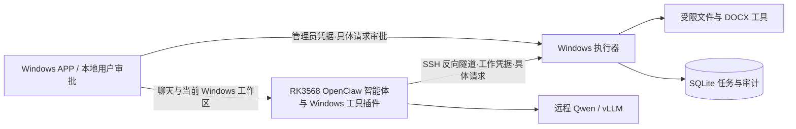

# 架构与信任边界

已实现 Windows 执行器、OpenClaw 工具插件、SSH 配对连接和 Quantum Harness 桌面 APP。APP 经 SSH 本地转发访问盒子认证聊天入口，在本机显示不可变请求并审批；管理员凭据留在本机。执行器和 APP 不持有模型 API Key，模型推理保持在远程服务器。

板子仍是智能体大脑：专用 quantum-harness agent 在 RK3568 上运行，不迁移到 Windows。它的配置只允许 Windows 插件工具操作用户成果；原生板子文件/执行工具不可调用。当前项目目录每轮传递，Windows AllowedRoots 强制限域，APP 的成功回执来自本地执行器。见 ADR 0005。

## 模块

- Contracts：DTO、工具描述、任务状态，不依赖 Web 或 SQLite。
- Configuration：启动配置及约束，缺少密钥或文件目录时拒绝启动。
- Security：恒定时间 token 比较、角色检查、规范化 JSON 请求摘要。
- Files / Word / Tools：路径策略、原子文件发布、Open XML 与工具注册。
- Persistence：参数化 SQL、审批消费、请求去重、任务状态、审计事务。
- Tasks：单个后台工作者领取持久化任务。
- Api / Program：HTTP 接口装配、错误映射与本机监听。

执行器实现留在一个宿主项目内；桌面 APP 是独立 WPF 项目，仅引用 Contracts，通过 HTTP 访问执行器，不直接依赖 SQLite 或文档实现包。目录创建/浏览、受限文件操作和 DOCX 格式修改复用同一请求审批与路径策略；DOCX 默认以最新 SHA256 核对后原子替换指定原件，显式另存为才新建文件。构建测试使用 ADR 0004 定义的隔离副本。

## 授权

审批端点只接受 admin token；工具客户端只持有 worker token。审批绑定请求编号、工具名称与规范化后的完整参数，五分钟过期，在入队事务中一次消费。相同请求编号与相同参数的重试返回原任务；更改参数返回冲突，不能借重试再次写文件。

盒子使用 worker 提交待审批请求；本地 Review-Requests.ps1 读取并显示完整参数，批准和任务入队在同一事务完成。不要把 admin token 提供给模型或盒子。开发演示脚本的直接审批接口保留，用于确定输入的测试。

## 数据与恢复

SQLite WAL 存放审批、任务与审计。程序启动前独占数据目录的实例锁；上次残留 queued/running 任务标记 interrupted，不自动重放写入。新启动后的任务进入 queued → running → succeeded/failed。

queued 的取消阻止执行；已经开始的短文件操作可能先完成提交，完成后的取消不会回滚文件。取消接口是尽力取消，不应把返回 requested=true 理解为写入已撤销。

## 边界

拒绝 UNC、设备路径、NTFS ADS、根目录之外路径以及现存祖先中的 junction/symlink。文件操作前重新检查路径，更新既有文本需提供当前 SHA-256。该策略不隔离同一 Windows 用户控制的其他进程；不能保证对恶意本地进程的文件系统竞态防御。部署时以普通用户运行，工作目录不要同时交给不受信任程序写入。

HTTP 仅监听 IPv4 loopback，Host 限制为 localhost/127.0.0.1，拒绝携带 Origin 的浏览器请求，所有业务接口要求角色凭据。跨设备采用核验主机密钥的 SSH 隧道，专用转发密钥只允许工具端口和认证网关端口。SQLite v2 的未决定请求重启后标记中断。桌面认证、会话、本地历史及恢复边界见 ADR 0003 和 desktop-gateway-v1.md。
